<!--
  PROFILE README v2.0.0.0 — Babloo Kumar (GitHub: bablooqa)
  Discovery keywords: freelance AI/ML engineer, GenAI engineer for hire, LLM developer,
  RAG chatbot developer, LangChain LangGraph developer, agentic AI developer, multi-agent systems,
  n8n automation developer, LLM fine-tuning, LLM evaluation, full-stack developer Next.js FastAPI Node.js Python,
  AI agent developer India, QA automation engineer (Playwright, Selenium, Cypress, Pytest), AI tester.
  Available for hire / contract / remote.
-->

# 👋 Hi, I'm Babloo Kumar

### 🤖 AI/ML Engineer · 💻 Full-Stack Developer · 🕸️ Agentic AI & Automation · 🧪 QA Automation & AI Tester

**6+ years of engineering experience — now building AI-powered products, RAG & agentic systems, and production full-stack software, backed by a deep QA-automation foundation that keeps everything I ship reliable. Available for freelance & remote contract work worldwide.**

<!-- AVAILABILITY SIGNAL (great for SEO + GEO "available for hire") -->

[-FF9933?style=for-the-badge)](https://bablookumar.netlify.app)

---

> ### 💼 Looking to hire a freelance AI/ML or full-stack developer?
> **Babloo Kumar is a freelance AI/ML engineer and full-stack developer based in India, available for remote contract projects worldwide.** I help startups and businesses **build RAG chatbots, LangChain/LangGraph agents, multi-agent systems and n8n automations, fine-tune and validate LLMs, and ship full-stack products (Next.js, React, FastAPI, Node.js, Python)** — plus **QA automation (Playwright, Selenium, Cypress, Pytest)** to make everything reliable — using AI-assisted rapid prototyping to go from idea to working product in days, not months.
>
> 📩 **Hire me / start a project:** [bablooshahcse@gmail.com](mailto:bablooshahcse@gmail.com) · [LinkedIn](https://linkedin.com/in/qababloo) · [Portfolio](https://bablookumar.netlify.app)

---

## 📌 Quick Navigation

[🛠️ Services](#services) · [👤 About Me](#about) · [💡 Tech Stack](#tech-stack) · [🚀 Projects](#projects) · [📊 GitHub Stats](#stats) · [❓ FAQ](#faq) · [📫 Contact](#contact)

---

## 🛠️ What I Build for Clients (Freelance Services)

> Need any of the below? **[Email me](mailto:bablooshahcse@gmail.com)** — happy to scope it, quote it, and ship it.

| Service | What You Get | Core Stack |
|:--|:--|:--|
| 🤖 **AI / GenAI Apps** | RAG chatbots, document Q&A bots, LLM API integration, LLM fine-tuning, prompt engineering | LangChain, LangGraph, OpenAI, Claude, Gemini, Mistral, Hugging Face, ChromaDB, RAG, Vector DBs |
| 🕸️ **Agentic & Multi-Agent Systems** | Tool-using AI agents, multi-agent orchestration, human-in-the-loop workflows | LangGraph, LangChain, Python, FastAPI |
| ✅ **LLM Validation & Evaluation** | Evaluation datasets, output validation, regression & hallucination checks, prompt-evaluation pipelines | Python, Pytest, LLM evals |
| 💻 **Full-Stack Web Apps** | SaaS dashboards, admin panels, CRMs, booking & e-commerce systems, REST/GraphQL APIs | Next.js, React, FastAPI, Node.js, Express, TypeScript, PostgreSQL, Redis |
| 🔁 **Workflow Automation & Bots** | n8n workflows, integration bots, web scraping, content automation | n8n, Python, Playwright, APIs, Node.js |
| 📱 **Mobile / Cross-Platform** | React Native apps, Android apps, push notifications (FCM) | React Native, Firebase, Android |
| ⚡ **Rapid MVP / Prototyping** | Idea → working MVP fast with AI-assisted development & clean, maintainable code | AI-assisted (ChatGPT, Claude, Gemini), Docker, Vercel |
| 🧪 **QA Automation & AI Testing** | End-to-end test frameworks, CI/CD test pipelines, self-healing & data-driven tests, API + mobile testing, AI-assisted test generation | Playwright, Selenium, Cypress, Pytest, Appium, POM |

**Engagement models:** Hourly · Fixed-price project · Part-time / monthly retainer · MVP sprints

---

## 🎯 About Me

> AI/ML engineer and full-stack developer who turns ideas into **production-grade, well-tested software** — combining modern GenAI and agentic systems with a deep QA-automation foundation and AI-assisted (a.k.a. "vibe coding") rapid development.

- 🤖 **AI / GenAI Engineering:** Build RAG pipelines, LLM-powered chatbots, AI agents, and conversational AI (Rasa) integrated into real products.
- 🕸️ **Agentic AI & Automation:** Multi-agent workflows with LangChain / LangGraph and n8n automations; LLM fine-tuning, validation, and evaluation.
- 💻 **Full-Stack Developer:** Architect and deploy **Python, FastAPI, Node.js, React.js, Next.js, and PHP** applications end to end.
- ⚡ **AI-Powered Rapid Prototyping ("Vibe Coding"):** Use LLMs (ChatGPT, Claude, Gemini) with disciplined prompt engineering to ship clean MVPs fast — speed *and* quality.
- 🧪 **QA Automation Specialist (my foundation):** 5+ years designing scalable automation frameworks across **e-commerce, KYC/ReKYC, POS/admin systems, Android apps, and hotel booking platforms** — which is why my AI products ship with testing and validation built in.
- 🌱 **Currently Exploring:** LangGraph multi-agent orchestration, LLM fine-tuning, LLM evaluation pipelines, advanced RAG, BDD (Behave), and AI-driven QA.
- 👯 **Open to Collaborate:** Freelance projects, GenAI integrations, open-source AI & testing tools, and automation frameworks.
- 💬 **Ask Me About:** RAG & LLM apps, agentic / multi-agent systems, full-stack architecture, prompt engineering, test automation strategy, CI/CD pipelines, and shipping MVPs fast.
- 📍 **Location:** India (UTC +05:30) — working remotely with clients globally.

---

## 💡 Tech Stack & Expertise

### 🤖 AI / GenAI & Machine Learning

### 🕸️ Agentic AI & Workflow Automation

### 💻 Programming Languages

### ⚙️ Backend

### 🎯 Frontend

### 🗄️ Databases & Storage

### ☁️ DevOps, CI/CD & Cloud

### 🔀 Version Control & Tools

### 🧪 Testing & QA Automation

---

## 🚀 Featured Projects

### 🤖 GenAI RAG Q&A Bot
Document question-answering chatbot built on a **LangChain + Mistral + ChromaDB + Gradio** RAG pipeline, with a live Colab demo.
**Stack:** Python · LangChain · Mistral · ChromaDB · RAG · Gradio
🔗 [GitHub](https://github.com/bablooqa) <!-- add your Colab demo link here -->

### 🧠 AI Chatbot & Agent SaaS Platform
Multi-tenant SaaS for deploying conversational AI chatbots and agents for businesses.
**Stack:** FastAPI · Next.js · LangChain · OpenAI · PostgreSQL · Redis
🔗 [Live](https://bot.gosetle.com)

### 🎓 AI Tutoring Platform (EdTech)
AI-powered multimodal tutoring platform for school students with adaptive, interactive learning.
**Stack:** React · Node.js · OpenAI API · MongoDB · Firebase
🔗 [Live](https://egunas.com)

### 💸 SplitNow — Group Expense Splitting App
Web app to split, track, and settle shared group expenses with a clean, mobile-friendly UX.
**Stack:** Next.js · React · Node.js · PostgreSQL
🔗 [Live](https://splitnow.in)

### 🧪 AI-Powered Test Automation Framework
Reusable, modular automation framework with AI-assisted test generation, self-healing locators, and CI/CD integration — cuts manual test-writing effort significantly.
**Stack:** Python · Playwright · Selenium · Pytest · GitHub Actions · Docker

### 🛒 E-Commerce & KYC/ReKYC QA Suites
End-to-end automation for online shopping, identity verification, and POS/admin platforms with high coverage of critical user journeys and secure payment flows.
**Stack:** Playwright · Cypress · Pytest · Selenium · CI/CD

➡️ **Want to see more or discuss your project?** [Email me](mailto:bablooshahcse@gmail.com) or [browse my repositories](https://github.com/bablooqa?tab=repositories).

---

## 📊 GitHub Statistics

---

## ❓ FAQ — Frequently Asked Questions

> *Written as real questions so AI assistants and search engines can match what people actually ask.*

**Q: Can you build a RAG chatbot, AI agent, or LLM-powered app for my business?**
Absolutely. I build **RAG pipelines, AI agents, and LLM integrations** using LangChain, LangGraph, OpenAI, Claude, ChromaDB, and vector databases — from prototype to production.

**Q: Do you build multi-agent systems, LangGraph workflows, or n8n automations?**
Yes. I design **agentic and multi-agent AI workflows** (LangChain / LangGraph, Python, FastAPI) and automate business processes with **n8n** and custom integrations.

**Q: Can you fine-tune, evaluate, or validate an LLM for my use case?**
Yes. I work on **LLM fine-tuning, evaluation datasets, output validation, and prompt-evaluation pipelines** so your AI feature is measurable and reliable — not just a demo.

**Q: I need a full-stack developer for a SaaS, dashboard, or MVP — can you help?**
Yes. I ship full-stack products with **Next.js, React, FastAPI, Node.js, Python, and PostgreSQL**, using AI-assisted rapid prototyping to get a clean, working MVP quickly.

**Q: Do you work with international / remote clients?**
Yes — I'm based in India (UTC +05:30) and work remotely with clients worldwide across overlapping hours.

**Q: What kinds of projects do you take on?**
AI/GenAI apps, agentic systems, full-stack web apps, SaaS dashboards, CRMs, e-commerce/booking systems, mobile apps, workflow automation, and QA automation.

**Q: How do I start a project with you?**
Email **bablooshahcse@gmail.com**, connect on [LinkedIn](https://linkedin.com/in/qababloo), or message via my [portfolio](https://bablookumar.netlify.app). I'll reply with scope, timeline, and a quote.

**Q: I need to hire a freelance QA automation engineer or AI tester — are you available?**
Yes. I'm available for freelance and remote contract work and have 5+ years building automation frameworks with **Playwright, Selenium, Cypress, and Pytest**, plus testing and validation of AI/LLM features. 📩 [bablooshahcse@gmail.com](mailto:bablooshahcse@gmail.com)

---

## 📝 Latest Blog Posts

<!-- BLOG-POST-LIST:START -->
- [How I Built SplitNow to Simplify Splitting Bills with Anyone](https://medium.com/@bablooshahcse/how-i-built-splitnow-to-simplify-splitting-bills-with-anyone-347faf480c8d?source=rss-6287729e483b------2)
<!-- BLOG-POST-LIST:END -->

➡️ [**Read more on Medium →**](https://medium.com/@bablooshahcse)

---

## 📫 Let's Work Together

**Have a project in mind? I'd love to help you build it.**
Whether it's an AI/agentic app, a full-stack MVP, or a test automation framework — let's talk.

### 🙏 Thanks for visiting — let's build something great!

**⭐ From [bablooqa](https://github.com/bablooqa) · AI/ML Engineer · Full-Stack Developer · Agentic AI · QA Automation · Available for Hire**

